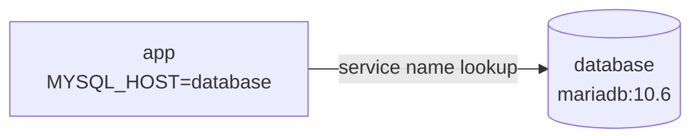

# Docker Compose Guide

This guide explains the Compose file from Laboratory 06 so that someone new to the project can follow it.

---

## The File

```yaml
version: '3'
services:
  database:
    image: mariadb:10.6
    environment:
      - MYSQL_ROOT_PASSWORD=cloudnova_root
      - MYSQL_PASSWORD=cloudnova_pass
      - MYSQL_DATABASE=nextcloud_db
      - MYSQL_USER=nextcloud_user
  app:
    image: nextcloud
    ports:
      - 8080:80
    environment:
      - MYSQL_PASSWORD=cloudnova_pass
      - MYSQL_DATABASE=nextcloud_db
      - MYSQL_USER=nextcloud_user
      - MYSQL_HOST=database
```

### Keys at a glance

| Key | Purpose |
|---|---|
| `version` | Declares which Compose file format is being used |
| `services` | Parent block that holds every container in the stack |
| `image` | The Docker image a container is built from |
| `ports` | Publishes a container port on the host (`8080` on the host to `80` in the container) |
| `environment` | Settings handed to the container when it starts |

---

## Question 1: What is the `services:` block for?

It is the section where I declare all the containers that make up the application. Every entry placed beneath it becomes one service. Here there are two, `database` and `app`. For each one I describe how it should run: which image, which ports, and which environment variables. When I run `docker-compose up -d`, Compose goes through this block and creates every container listed in it.

## Question 2: How did Nextcloud locate the database?

The answer is the setting `MYSQL_HOST=database` in the `app` service. `database` is the name I gave the MariaDB service. When Compose starts a stack, it connects all of its services to one private network and lets them look each other up by service name, which works like a built-in DNS. So Nextcloud simply asks for `database` and gets directed to the MariaDB container, and I never had to find or write down an IP address.



## Question 3: `docker run` compared with `docker-compose up -d`

| Point of comparison | `docker run` | `docker-compose up -d` |
|---|---|---|
| Number of containers | One per command | Every service in the file |
| How it is configured | Flags typed on the command line | A YAML file |
| Repeating it later | Have to retype or recall the command | Run the same file again |
| Networking | Needs to be set up by hand | Created automatically for the stack |
| Fit for IaC | Weak, since the setup only lives in shell history | Strong, since the file can be stored in Git |

The `-d` option stands for *detached*. It runs the containers in the background so I can keep using the terminal.

To sum up, `docker run` is fine for trying out a single container quickly. For an application with more than one container, Compose is the better choice because the whole setup is written down in a file and started with one command.
