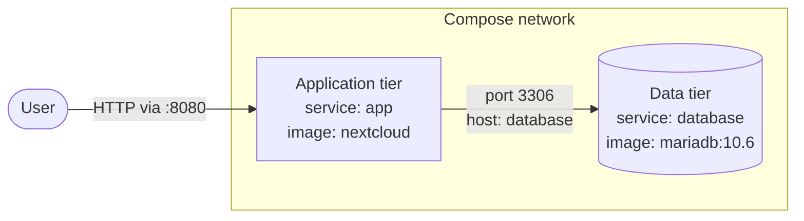

# Multi-Tier Architecture: The Nextcloud Two-Tier Design

**Scenario:** CloudNova private cloud storage (proof of concept)
**Components:** Nextcloud as the application tier, MariaDB as the database tier

---

## Definition

A multi-tier architecture divides an application into layers, where each layer has one responsibility and talks only to the layer next to it. Mine has two tiers, so it is a **two-tier** design: one layer that users deal with directly, and one layer that holds the data. Each layer runs in its own container.

## Tier 1: Application (service `app`)

- **Image:** `nextcloud`
- **Published port:** `8080:80`
- **Role:** Shows the web interface, receives the browser's requests, and runs the logic for logging in, uploading, and sharing files.
- **Exposure:** This is the only part of the stack that is reachable from outside, through port 8080.

## Tier 2: Data (service `database`)

- **Image:** `mariadb:10.6`
- **Port:** `3306`, used only inside the Compose network
- **Role:** Keeps the data that has to survive restarts, such as accounts, settings, and file records. Nextcloud queries it whenever it needs that information.
- **Exposure:** No port is published to the host, so nothing outside the network can connect to it directly.

## Reasons for Keeping the Tiers Separate

1. **Independent maintenance.** I can restart or upgrade the web container without disturbing the database, and the reverse is also true. Each tier could also be scaled on its own later.
2. **Better security.** Because the database has no public port, an attacker has to get through the application tier first.
3. **Easier troubleshooting.** Every container does one job, so when something breaks, it is clear which one to inspect first.
